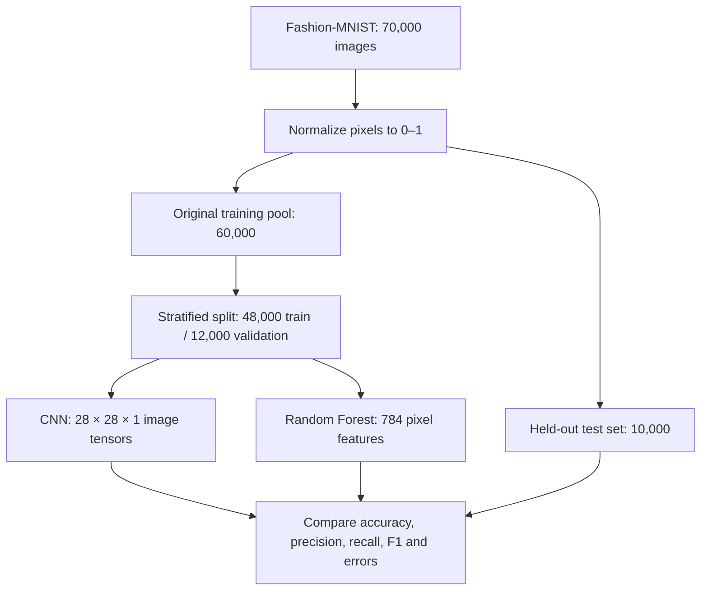

# Fashion-MNIST Image Classification: CNN vs. Random Forest

**Portfolio case study | Computer vision · Supervised machine learning · Model evaluation**

> **Key finding:** A convolutional neural network (CNN) achieved **91.03% test accuracy**, compared with **87.49%** for a Random Forest on Fashion-MNIST—a **3.54-percentage-point advantage**. The Random Forest trained approximately **8.9× faster** in the recorded experiment but showed a substantially larger training-to-test performance gap.

**Project code:** [`fashion_classifier.py`](fashion_classifier.py)  
**Dataset:** [Fashion-MNIST](https://github.com/zalandoresearch/fashion-mnist)  
**Status:** Completed experimental benchmark; **not** a deployed retail application.

## 1. Project at a glance

This project compares two approaches to classifying clothing images: a **convolutional neural network**, which learns spatial features from images, and a **Random Forest**, which classifies flattened pixel vectors. Both methods were trained and evaluated on the same data partitions to investigate how architectural differences affect accuracy, generalization, category-level errors, and training cost.

The question was not simply *which model achieves the higher score?* It was also *where does each model fail, how much does it overfit, and what trade-offs matter when selecting a model?*

**Work demonstrated:** data preparation; stratified data splitting; TensorFlow/Keras model construction and training; scikit-learn classification; comparative evaluation; precision, recall, and F1-score analysis; confusion-matrix generation; and interpretation of performance/cost trade-offs.

## 2. Task and dataset

Fashion-MNIST, introduced by Xiao, Rasul, and Vollgraf (2017), contains **70,000 grayscale images**, each **28 × 28 pixels**, distributed across **10 clothing categories**. The original dataset provides 60,000 training images and 10,000 test images.

The 60,000-image training portion was further split using **stratified sampling** (`random_state=42`) into:

| Partition | Images | Role |
|---|---:|---|
| Training | 48,000 | Fit both classifiers |
| Validation | 12,000 | Monitor and compare performance before testing |
| Test | 10,000 | Evaluate performance on the dataset's held-out test partition |

The ten labels are T-shirt/top, Trouser, Pullover, Dress, Coat, Sandal, Shirt, Sneaker, Bag, and Ankle boot.

### Preprocessing and feature representation

- Pixel values were converted to floating-point numbers and normalized from **0–255 to 0–1**.
- For the **CNN**, images were reshaped to **28 × 28 × 1** tensors to retain their two-dimensional organization.
- For the **Random Forest**, images were flattened into **784-feature vectors**. Each pixel remains a feature, but the classifier does not explicitly model neighboring-pixel structure through convolution.
- Both models used the **same train, validation, and test partitions**.



## 3. Models and experimental setup

### 3.1 Convolutional neural network (CNN)

The CNN was implemented in **TensorFlow/Keras** using a straightforward Sequential architecture:

| Stage | Configuration |
|---|---|
| Input | 28 × 28 × 1 grayscale image |
| Convolution 1 | 32 filters, 3 × 3 kernel, ReLU |
| Pooling 1 | 2 × 2 max pooling |
| Convolution 2 | 64 filters, 3 × 3 kernel, ReLU |
| Pooling 2 | 2 × 2 max pooling |
| Convolution 3 | 64 filters, 3 × 3 kernel, ReLU |
| Flatten | 576 features |
| Hidden dense layer | 64 neurons, ReLU |
| Output | 10 neurons, softmax |

The model contains **93,322 parameters**. It was trained for **10 epochs**, with a **batch size of 32**, the **Adam optimizer**, and **sparse categorical cross-entropy** loss.

This is a standard educational CNN pattern, closely related to the architecture demonstrated in TensorFlow's [Convolutional Neural Network tutorial](https://www.tensorflow.org/tutorials/images/cnn), adapted here for Fashion-MNIST's single-channel input and ten clothing classes. The approach is **not presented as a novel neural-network architecture**.

### 3.2 Random Forest baseline

The baseline was implemented with **scikit-learn's `RandomForestClassifier`**:

| Parameter | Value |
|---|---|
| Number of trees | 100 |
| Split criterion | Entropy |
| Maximum tree depth | 100 |
| Random state | 42 |
| Parallelization | All available CPU cores (`n_jobs=-1`) |
| Input | 784 normalized pixel values per image |

The forest combines predictions from multiple decision trees and serves as a conventional machine-learning comparison against the CNN's learned spatial features. The evaluation uses a **single configuration per model**, rather than an exhaustive hyperparameter search.

## 4. Results

The following figures are the **recorded results of the original experiment**, as reported in the accompanying coursework analysis and repository README. They are not the results of a new run performed for this portfolio document; execution times and some scores may vary when the script is rerun.

### 4.1 Overall benchmark

| Metric | CNN | Random Forest |
|---|---:|---:|
| Training accuracy (post-training predictions) | **95.81%** | **100.00%** |
| Validation accuracy | **91.25%** | **88.52%** |
| Test accuracy | **91.03%** | **87.49%** |
| Weighted test F1-score | **0.910** | **0.873** |
| Recorded training time | **98.56 s** | **11.08 s** |
| Training–test accuracy gap | **4.78 pp** | **12.51 pp** |

**Interpretation:** The CNN improved held-out test accuracy by **3.54 percentage points** and had a notably smaller train–test gap. The forest attained **100% training accuracy** but **87.49% test accuracy**, which is evidence of overfitting under this configuration. The forest's observed training time was about **8.9 times shorter**; this is a measurement from one experimental setup, not a universal speed ratio.

The CNN's *final-epoch training accuracy* reported by Keras (**94.71%**) is different from the **95.81% post-training training-set accuracy** above. These are different measurements: one is the epoch's running training metric; the other is recomputed with the final model after training.

### 4.2 Class-level test performance

Precision measures how often a class prediction is correct; recall measures how often examples from that class are correctly found. The following values come from the recorded test-set results.

| Class | CNN precision | CNN recall | RF precision | RF recall |
|---|---:|---:|---:|---:|
| T-shirt/top | 0.852 | 0.876 | 0.821 | 0.864 |
| Trouser | 0.994 | 0.980 | 0.994 | 0.964 |
| Pullover | 0.850 | 0.883 | 0.762 | 0.787 |
| Dress | 0.923 | 0.902 | 0.868 | 0.907 |
| Coat | 0.812 | 0.910 | 0.758 | 0.806 |
| Sandal | 0.987 | 0.973 | 0.980 | 0.961 |
| **Shirt** | **0.784** | **0.675** | **0.718** | **0.583** |
| Sneaker | 0.948 | 0.975 | 0.934 | 0.955 |
| Bag | 0.984 | 0.965 | 0.955 | 0.973 |
| Ankle boot | 0.971 | 0.964 | 0.949 | 0.949 |

The most difficult category was **Shirt**. The CNN recalled **67.5%** of actual shirts, compared with **58.3%** for the Random Forest—an improvement of **9.2 percentage points**. Other upper-body garments, especially **Pullover** and **Coat**, also presented difficulties.

By contrast, visually distinctive categories such as **Trouser**, **Sandal**, **Sneaker**, **Bag**, and **Ankle boot** generally performed well. These patterns are consistent with the limited visual detail available in small grayscale images: similar upper-body silhouettes are easier to confuse than clearly distinct shapes.

### 4.3 Confusion matrices and learning behavior

The code generates separate **training and test confusion matrices for each model**, allowing errors to be inspected rather than relying solely on aggregate accuracy.

The original experiment identified frequent confusion among upper-body garments, particularly Shirt versus T-shirt/top and between Pullover and Coat. The Random Forest's perfect training-set confusion matrix contrasted with its less accurate test predictions. CNN test-set mistakes followed similar categories but were generally less frequent.

Across the CNN's 10 recorded epochs:

- Epoch training accuracy increased from **80.85%** to **94.71%**.
- Validation accuracy increased from **85.59%** to **91.25%**.
- Training loss declined from **0.5245** to **0.1399**.
- Validation loss declined early in training and ended at approximately **0.268**.

The final training/validation difference suggests some overfitting, but the CNN's held-out performance was stronger than the Random Forest's in this experiment.

## 5. Technical interpretation and decision-making

**Why the CNN performed better:** Its convolutions learn local spatial patterns, using neighboring pixels to form progressively higher-level representations. This inductive bias is useful for shapes and silhouettes. A standard Random Forest using flattened pixels can still discover predictive relationships, but it does not exploit spatial locality through a convolutional architecture.

**Why the Random Forest remains relevant:** It establishes a useful non-neural baseline, trains quickly in this configuration, and is comparatively simple to implement. A quick baseline helps establish whether the added complexity and training time of a neural model provide measurable value.

**Model-selection conclusion for this benchmark:** The CNN is the stronger candidate **for further development and validation** because it had higher accuracy and better generalization on Fashion-MNIST. The Random Forest remains a practical baseline or fast prototyping option. Neither model has been demonstrated to be production-ready by this benchmark alone.

## 6. Limitations and what I would improve next

The project is deliberately scoped as a controlled educational benchmark. Important limitations include:

1. **Synthetic simplicity of the benchmark:** 28 × 28 grayscale images do not reflect product photography with color, complex backgrounds, varying viewpoints, or multiple objects.
2. **Limited model selection:** Only one specified CNN and one Random Forest configuration were evaluated; there was no systematic hyperparameter optimization or data augmentation study.
3. **Single recorded run:** The comparison does not provide repeated-seed averages, uncertainty intervals, or statistical significance tests. The split and Random Forest are seeded, but the public script does not set every TensorFlow training seed.
4. **Hardware-dependent timings:** Training times were recorded in one environment; inference latency, memory use, energy consumption, and deployment cost were not benchmarked.
5. **No real-world deployment:** The results support choosing a model for additional testing, not claiming validated performance in an actual retail system.

Logical follow-up work would include repeated experiments with fully controlled seeds, hyperparameter tuning, data augmentation, a stronger baseline, prediction-error examples, and evaluation on more realistic retail imagery. If deployment becomes a goal, inference latency and memory requirements should be measured on the intended hardware.

## 7. Reproducing the project

The full experiment is implemented in [`fashion_classifier.py`](fashion_classifier.py). From a terminal:

```bash
git clone https://github.com/dorothea-ens/Fashion-MNIST-Classification-Project.git
cd Fashion-MNIST-Classification-Project
python -m pip install tensorflow scikit-learn numpy pandas matplotlib seaborn
python fashion_classifier.py
```

The script loads Fashion-MNIST through Keras, trains both classifiers, prints comparative metrics, and writes:

- **4 PNG confusion matrices:** CNN and Random Forest, training and test sets.
- **4 CSV classification reports:** CNN and Random Forest, training and test sets.
- **4 CSV confusion matrices:** the same four model/partition combinations.

The script's package dependencies are **not version-pinned** in this repository. Reproducible results across machines would benefit from a tested environment or lockfile. Generated outputs are produced locally when the script is executed and are not required to be stored in the repository.

## 8. Tools, references, and transparency

**Technical tools:** Python, NumPy, pandas, TensorFlow/Keras, scikit-learn, Matplotlib, Seaborn, Git/GitHub.

**AI-assistance disclosure:** The original project documentation disclosed the use of ChatGPT, Gemini, and DeepSeek as assistive tools during project development and reporting, with the work reviewed by the project author. This portfolio presentation was also prepared with AI drafting assistance and checked against the original project report and public Python code. The benchmark values are **reported experimental results**, not independently reproduced measurements for this document.

**Selected references**

1. Xiao, H., Rasul, K., & Vollgraf, R. (2017). *Fashion-MNIST: A novel image dataset for benchmarking machine learning algorithms.* [arXiv:1708.07747](https://arxiv.org/abs/1708.07747).
2. Breiman, L. (2001). *Random forests.* Machine Learning, 45, 5–32. [DOI](https://doi.org/10.1023/A:1010933404324).
3. TensorFlow. *Convolutional Neural Network (CNN).* [Tutorial](https://www.tensorflow.org/tutorials/images/cnn). Referenced for the standard Sequential CNN pattern.
4. TensorFlow. *Basic classification: Classify images of clothing.* [Tutorial](https://www.tensorflow.org/tutorials/keras/classification).
5. Kingma, D. P., & Ba, J. (2015). *Adam: A method for stochastic optimization.* [arXiv:1412.6980](https://arxiv.org/abs/1412.6980).

---

*This document is a public portfolio case study derived from a completed machine-learning experiment. It intentionally omits private identifiers and institutional submission material.*
